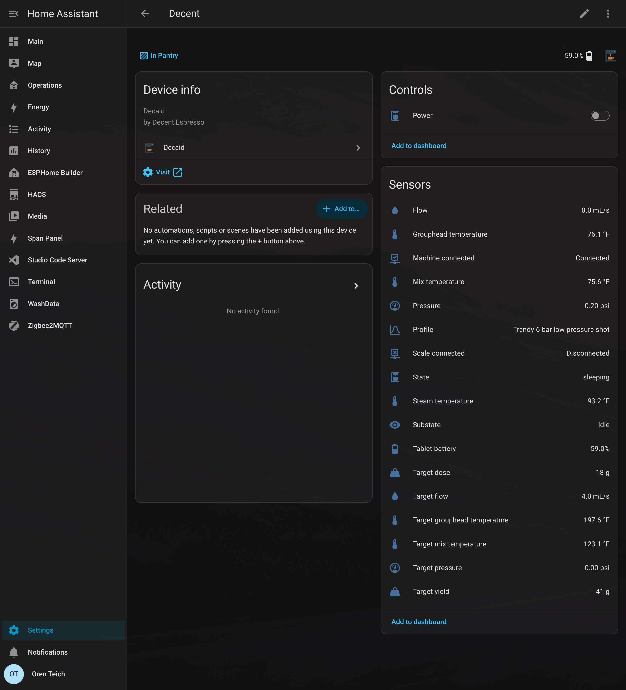

# Decaid for Home Assistant

Bring your Decent Espresso machine into Home Assistant through [Decaid](https://github.com/decentespresso/decaid)'s local API. This custom integration groups controls and sensors under one **Decent** device, with UI setup, live WebSocket telemetry, and REST commands and fallback polling.



## What you get

- **Device details**: the machine's model, serial number, and firmware version on the device page.
- **Wake/sleep switch** that only sends a wake command when the machine is sleeping, and refuses to send a busy machine to sleep.
- **Live telemetry** over WebSocket: state, substate, temperatures, pressure, flow, and their targets. State changes appear immediately; numerical updates are limited to about once per second while awake and once every 15 seconds while sleeping.
- **Water level** in millimeters, and a settable **refill threshold**.
- **Scale**: weight (g), weight flow (g/s), battery (%), and timer (ms), plus **Tare scale**, **Start/Stop/Reset scale timer** buttons.
- **Shots**: shot phase, last shot stop reason, a scale-lost-during-shot indicator, a Shot event entity for automations, and a **Last shot** sensor with the shot's details as attributes.
- **Shot settings you can change**: target steam temperature/duration, target hot-water temperature/volume/duration, target shot volume, and configured group temperature.
- **Machine settings you can change**: USB charger, fan threshold, tank temperature threshold, flush temperature/flow/timeout, hot water flow, steam flow, and steam purge mode.
- **Tablet**: battery, screen brightness, a screen keep-awake switch, presence detection, the idle sleep timeout, and a **Signal presence** button that restarts the sleep countdown (for example from a motion sensor).
- **Updates**: update entities for the Decaid app and for the machine firmware bundled with Decaid.
- **Bengle**: if the machine reports Bengle capabilities, a **Cup warmer** climate entity and cup warmer pre-warm controls.

Nothing here starts an operation on the machine. There are no controls to pull a shot, steam, dispense hot water, flush, or install updates; the power switch only wakes the machine or puts it to sleep.

### Data sources and availability

| Entities | Source | When unavailable |
| --- | --- | --- |
| Machine state, temperatures, pressure, flow | WebSocket; REST fallback | Machine disconnected or both sources fail |
| Machine and scale connectivity | WebSocket; REST fallback every 10 seconds | Device inventory unavailable |
| Profile, dose/yield targets, tablet battery | REST, every 60 seconds | Corresponding REST request fails |
| Water level and refill threshold | WebSocket changes; REST fallback every 60 seconds | Machine disconnected, or both sources fail |
| Scale measurements | WebSocket | Scale disconnect, stream failure, or 15 seconds without measurements |
| Shot phase, stop reason, event, scale-lost flag | WebSocket events | No initial snapshot or stream failure |
| Shot settings | WebSocket changes | No initial snapshot, stream failure, or machine disconnect |
| Last shot | REST, every 60 seconds, and 5 seconds after a shot ends | Corresponding REST request fails |
| Device details, refill kit, Bengle detection | REST, every 5 minutes and when the machine reconnects | Machine not connected |
| Machine settings, steam purge mode, USB charger | REST, every 5 minutes and after each change | Machine not connected |
| Screen brightness and keep-awake, presence, sleep timeout | REST, every 60 seconds and after each change | Tablet unreachable, or the tablet platform does not support the feature |
| Decaid app update | WebSocket changes; REST fallback every 60 seconds | Both sources fail |
| Machine firmware update | REST, hourly | Tablet unreachable, or no DE1 connected |
| Cup warmer and pre-warm (Bengle) | REST, every 30/60 seconds and after each change | Machine not connected |

After a successful wake/sleep command, the switch shows the requested state while the machine catches up, for up to 20 seconds. Fresh readings confirm it or restore the reported state.

Commands still use REST. Turning the switch off while the machine is busy (espresso, steam, hot water, flush, steam rinse, cleaning, descaling, calibration, self-test, air purge, or a firmware update) is refused with an error, because sleeping would abort the operation. Turning it off when the machine is already asleep sends nothing. If the device inventory is unavailable, the switch stays usable as long as the machine state can be read.

Connections stay open with heartbeat checks and automatic reconnects. If streaming fails, machine readings fall back to REST every 1–2 seconds while awake or 10 seconds while sleeping/unreachable; device connectivity falls back to 10-second polling. A disconnected machine’s readings are unavailable until fresh data arrives.

Water levels stream on change. The stream can stay quiet while the level is unchanged, and heartbeat checks monitor the connection. If it drops, the level is read over REST until it reconnects. Decaid builds from before November 2026 have no REST endpoint for water levels, so on those the water entities are unavailable until the stream returns. They are always unavailable while the machine is disconnected.

Scale readings also use streaming without REST fallback. They become unavailable on scale disconnect, stream failure, or 15 seconds without fresh measurements. A scale reconnect needs a fresh measurement before readings become available again. Numerical updates are limited to about once per second.

Shot settings use `ws/v1/machine/shotSettings` without REST fallback. They update immediately on change and can remain quiet indefinitely after the initial snapshot while heartbeat checks succeed. The entities become unavailable on stream or machine disconnect and require a fresh settings snapshot to recover. Temperatures are in °C, durations in seconds, and volumes in mL. Configured group temperature is the `groupTemp` setting, separate from the live grouphead/mix targets. Target shot volume is separate from the workflow's target yield in grams. The raw `steamSetting` field is not exposed, but changing any shot setting sends it back unchanged, because Decaid replaces all shot settings at once.

## Shot events

The **Shot event** entity emits `state`, `decision`, and `terminal` events individually, without throttling. Its attributes include `shot_id`, `phase`, `source_timestamp`, `scale_lost`, `decision` (kind, reason, and any additional context supplied by Decaid). The first frame after connecting restores the current shot sensors. Decaid replays its latest frame on every connection, so that frame fires an event only if it is newer than anything already received, meaning the event happened while the connection was down. The first frame after Home Assistant starts never fires an event. If several events happen during a disconnect, only the latest can be recovered.

**Last shot stop reason** retains the latest stop, abort, or terminal reason, including across Home Assistant restarts; a later finalize event does not overwrite it. **Scale lost during shot** follows Decaid's flag, which remains set for the rest of a shot even if the scale reconnects.

This feed describes Decaid's app-side sequencer. In full gateway mode no sequencer runs, so the feed stays idle. Shot phase is separate from the existing machine State/Substate sensors. Unlike continuous measurements, the shot stream may stay quiet between events; heartbeat checks keep its availability current.

## Changing settings

Settings are number, switch, and select entities in the device's **Configuration** section. A change is sent to Decaid at once; settings read over REST are reread straight away, and stream-backed ones (shot settings, refill threshold) update when the machine reports the new value.

- **Target steam temperature**: Decaid treats anything below 135 °C as steam off.
- **Refill threshold** is in millimeters and is kept by Decaid per machine.
- **Fan threshold** and the refill kit override are kept by Decaid per machine and reapplied when it reconnects.
- **Steam purge mode** is `normal` or `two_tap_stop`.
- **Sleep timeout** of 0 turns Decaid's idle sleep off. **Signal presence** only works while **Presence detection** is on, and it does not wake a sleeping machine.
- **Tablet screen keep awake** holds the screen on until you turn it off.

The ranges offered are the ones Decaid's own settings page uses. Decaid does not validate most of these values, so stay within what your machine supports.

## Last shot

**Last shot** shows when the newest shot in Decaid's history was pulled. Its attributes give the profile, dose, yield and brew ratio, targets, duration, peak pressure and flow, final scale weight, stop reason, coffee, grinder and grind setting, barista and drinker, and any enjoyment, TDS, extraction yield, or notes recorded for it. Dose and yield use the values recorded on the shot when present, falling back to the scale weight and then the workflow targets. Attributes Decaid does not have are left out.

It updates 5 seconds after Decaid's sequencer reports the end of a shot, and otherwise every 60 seconds.

## Updates

**Decaid app** shows the installed app version and whether Decaid has found a newer one, with release notes and live progress while the tablet downloads and installs it. **Machine firmware** compares the connected DE1's firmware with the newest build bundled with Decaid; it is unavailable for a Bengle or when no machine is connected. Neither can be installed from Home Assistant: install app updates on the tablet, and flash firmware from Decaid while you are at the machine.

## Bengle

When Decaid reports that the connected machine is a Bengle, these entities are added:

- **Cup warmer**: a climate entity with the live mat temperature, whole-degree setpoint (0–80 °C), and heat/off mode. While it is on, it shows as heating below the setpoint and idle once the mat has reached it.
- **Cup warmer pre-warm** and **Cup warmer pre-warm lead time** (0–120 minutes): warm the mat ahead of a scheduled wake.
- **Cup warmer pre-warming**: whether pre-warm is running now.

They appear as soon as the Bengle connects, including after Home Assistant has started, and stay on the device (unavailable) if it later disconnects. A plain DE1 gets none of them.

## State and readiness

**State** reports the operation (`sleeping`, `idle`, `espresso`, `needsWater`, etc.). **Substate** adds detail such as `preparingForShot`, `preinfusion`, and `pouring`. Decaid maps DE1 heater warm-up/stabilization to `preparingForShot`; the main state may still say `idle`.

The API snapshot has no explicit brew-ready flag. `idle` alone does not establish thermal readiness; watch grouphead/mix temperatures against their targets. The integration preserves the raw states for automations.

## Install

Requires Home Assistant 2026.10+ and Decaid running with its local API reachable from Home Assistant (port `8080` by default). Decaid's API varies by version: if optional streams are missing, their entities will remain unavailable. Use a current Decaid release for the full feature set.

[Open this repository in HACS or Marketplace](https://my.home-assistant.io/redirect/hacs_repository/?owner=teich&repository=ha-decaid&category=integration)

1. On Home Assistant 2026.11 and later, open **Settings → Marketplace**, connect GitHub if needed, and add `https://github.com/teich/ha-decaid` as a custom **Integration** repository. On earlier versions, add it under **HACS → Custom repositories** instead. The link above works with both.
2. Download **Decaid — Decent Espresso**. Restart Home Assistant if prompted; HACS installations normally require a restart.
3. Open **Settings → Devices & services → Add integration → Decaid**.
4. Enter the IP address or hostname of the device running Decaid and its port (default `8080`). There is no automatic discovery, so give the tablet a DHCP reservation or a stable hostname. Leave the optional machine device ID blank unless you need to match a specific machine; if you enter one, setup checks that Decaid lists it. Setup succeeds while the machine itself is off, as long as the tablet answers.

Existing HACS installations and custom repositories migrate to Marketplace when upgrading to Home Assistant 2026.11. Decaid remains a community custom integration.

Use **Reconfigure** if the address changes; entity IDs stay the same.

**Replacing the tablet?** Either use **Reconfigure** with the new tablet's address, or add the integration again with the new tablet once it is connected to the machine. The integration recognises the machine by its serial number and moves the existing Decent device to the new tablet, keeping its entities and history, instead of adding a second one. The serial is recorded the first time the machine connects with this version installed, so update before swapping tablets. If you set a machine device ID, enter the new tablet's value or leave it blank, because each tablet can report a different ID for the same machine. Moving from REST YAML? Remove your old Decent REST sensors, commands, and template switch first. Existing entities aren't migrated automatically, so check entity IDs in dashboards and automations.

### Updating

Updates are available through HACS or Marketplace. Restart Home Assistant if prompted after updating. Entities normally keep their IDs across updates, and no reconfiguration is needed.

**Upgrading to 0.4.0:** the shot settings and refill threshold are now number entities you can change, so they moved from `sensor.decent_…` to `number.decent_…` (for example `sensor.decent_target_steam_temperature` is now `number.decent_target_steam_temperature`). The old sensors are removed automatically; update any dashboards and automations that use them.

## Database size

Live readings are rounded before they are stored (0.1 °C, 0.1 bar, 0.1 mL/s, 0.1 g, 0.1 mm), so measurement jitter does not create new states. While the machine sleeps, numerical readings update at most every 15 seconds. During a shot they update about once per second, which is what makes shot graphs useful.

If you don't need history for some sensors, exclude them from the recorder in `configuration.yaml`:

```yaml
recorder:
  exclude:
    entity_globs:
      - sensor.decent_target_*
      - sensor.decent_mix_temperature
```

Connectivity and battery sensors are diagnostic entities, so they are kept off auto-generated dashboards.

## Troubleshooting

- If setup cannot connect, check that Decaid is running and that `http://<ip>:8080/api/v1/machine/state` is reachable from the Home Assistant host; substitute your configured port.
- The tablet may be reachable while the machine or scale is disconnected. Check the connection entities and reconnect the device in Decaid.
- Stream-only water, scale, shot, and shot-settings entities need an initial frame. Check the Decaid version and connection if they remain unavailable. Shot events cannot be recovered after a disconnect.
- A stream that fails five times in a row logs one warning, and an info message when it recovers. For more detail, enable debug logging for `custom_components.decaid`.
- To report a problem, download diagnostics from the integration's menu under **Settings → Devices & services → Decaid**. The download redacts the tablet address, device names, and IDs, and includes only the names of tablet settings, not their values. Include it with your Home Assistant and Decaid versions in an issue. Review any logs you attach for private network details before sharing.

## AI disclaimer

This integration was written by AI. It's an unofficial community project, with no affiliation to Decent Espresso and no warranty. Review it and use it at your own risk.

[Report an issue](https://github.com/teich/ha-decaid/issues) · [Decaid API reference](https://github.com/decentespresso/decaid/blob/main/doc/Api.md)
