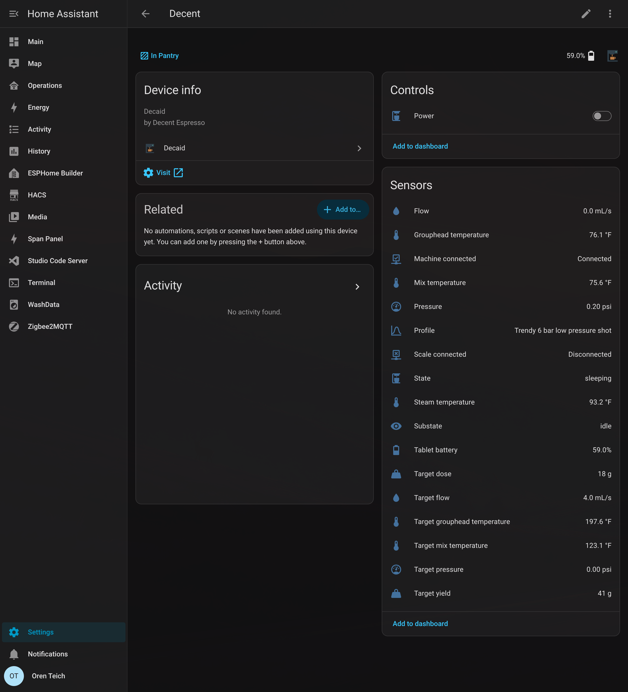

# Decaid for Home Assistant

Bring your Decent Espresso machine into Home Assistant through [Decaid](https://github.com/decentespresso/decaid)'s local API. This custom integration groups controls and sensors under one **Decent** device, with UI setup, live WebSocket telemetry, and REST commands and fallback polling.

## What you get

- Wake/sleep switch that only sends a wake command when the machine is sleeping.
- Live state, substate, temperatures, pressure, flow, and their targets over WebSocket. State changes appear immediately; numerical updates are limited to about once per second.
- Live machine/scale connectivity. Profile, dose/yield targets, and tablet battery refresh over REST every 60 seconds.
- Water level and refill threshold in millimeters over WebSocket. These are read-only sensors; the threshold is the value reported by the machine.
- Scale weight (g), weight flow (g/s), battery (%), and timer (ms) over WebSocket. Battery and timer are unknown when the scale does not report them; an unset timer is also unknown.
- Shot phase, last shot stop reason, and a scale-lost-during-shot indicator from Decaid's sequencer, plus a Shot event entity for automations.
- Read-only shot settings: target steam temperature/duration, target hot-water temperature/volume/duration, target shot volume, and configured group temperature.

### Data sources and availability

| Entities | Source | When unavailable |
| --- | --- | --- |
| Machine state, temperatures, pressure, flow | WebSocket; REST fallback | Machine disconnected or both sources fail |
| Machine and scale connectivity | WebSocket; REST fallback | Device inventory unavailable |
| Profile, dose/yield targets, tablet battery | REST, every 60 seconds | Corresponding REST request fails |
| Water level and threshold | WebSocket changes | No initial snapshot, stream failure, or machine disconnect |
| Scale measurements | WebSocket | Scale disconnect, stream failure, or 15 seconds without measurements |
| Shot phase, stop reason, event, scale-lost flag | WebSocket events | No initial snapshot or stream failure |
| Shot settings | WebSocket changes | No initial snapshot, stream failure, or machine disconnect |

After a successful wake/sleep command, the switch shows the requested state while the machine catches up, for up to 20 seconds. Fresh readings confirm it or restore the reported state.

Commands still use REST. The sleep command can interrupt a running operation.

Connections stay open with heartbeat checks and automatic reconnects. If streaming fails, machine readings fall back to REST every 1–2 seconds while awake or 10 seconds while sleeping/unreachable; device connectivity falls back to 60-second polling. A disconnected machine’s readings are unavailable until fresh data arrives.

Water levels have no REST GET fallback. The water sensors remain unavailable until their first frame and become unavailable if their stream or the machine disconnects. After the initial snapshot, the stream can stay quiet while the level is unchanged; heartbeat checks monitor the connection. Fresh frames restore availability.

Scale readings also use streaming without REST fallback. They become unavailable on scale disconnect, stream failure, or 15 seconds without fresh measurements. A scale reconnect needs a fresh measurement before readings become available again. Numerical updates are limited to about once per second.

Shot settings use `ws/v1/machine/shotSettings` without REST fallback. They update immediately on change and can remain quiet indefinitely after the initial snapshot while heartbeat checks succeed. Sensors become unavailable on stream or machine disconnect and require a fresh settings snapshot to recover. Temperatures are in °C, durations in seconds, and volumes in mL. Configured group temperature is the `groupTemp` setting, separate from the live grouphead/mix targets. Target shot volume is separate from the workflow's target yield in grams. The raw `steamSetting` field is retained in the payload but is not exposed as a sensor.

## Shot events

The **Shot event** entity emits `state`, `decision`, and `terminal` events individually, without throttling. Its attributes include `shot_id`, `phase`, `source_timestamp`, `scale_lost`, `decision` (kind, reason, and any additional context supplied by Decaid). The first frame after connecting restores the current shot sensors but does not fire an event, since Decaid replays its latest frame. Events missed while disconnected cannot be recovered from this feed.

**Last shot stop reason** retains the latest stop, abort, or terminal reason received during this integration session; a later finalize event does not overwrite it. **Scale lost during shot** follows Decaid's flag, which remains set for the rest of a shot even if the scale reconnects.

This feed describes Decaid's app-side sequencer. In full gateway mode no sequencer runs, so the feed stays idle. Shot phase is separate from the existing machine State/Substate sensors. Unlike continuous measurements, the shot stream may stay quiet between events; heartbeat checks keep its availability current.

Updates are available through HACS or Marketplace. Restart Home Assistant if prompted after updating. Existing entities and automations keep their IDs; no reconfiguration is needed.

## State and readiness

**State** reports the operation (`sleeping`, `idle`, `espresso`, `needsWater`, etc.). **Substate** adds detail such as `preparingForShot`, `preinfusion`, and `pouring`. Decaid maps DE1 heater warm-up/stabilization to `preparingForShot`; the main state may still say `idle`.

The API snapshot has no explicit brew-ready flag. `idle` alone does not establish thermal readiness; watch grouphead/mix temperatures against their targets. The integration preserves the raw states for automations.

## Install

Requires Home Assistant 2026.10+ and Decaid running with its local API reachable from Home Assistant (port `8080` by default). Decaid's API varies by version: if optional streams are missing, their entities will remain unavailable. Use a current Decaid release for the full feature set.

[Open this repository in HACS or Marketplace](https://my.home-assistant.io/redirect/hacs_repository/?owner=teich&repository=ha-decaid&category=integration)

1. On Home Assistant 2026.11 and later, open **Settings → Marketplace**, connect GitHub if needed, and add `https://github.com/teich/ha-decaid` as a custom **Integration** repository. On earlier versions, add it under **HACS → Custom repositories** instead. The link above works with both.
2. Download **Decaid — Decent Espresso**. Restart Home Assistant if prompted; HACS installations normally require a restart.
3. Open **Settings → Devices & services → Add integration → Decaid**.
4. Enter the IP address of the device running Decaid and its port (default `8080`). There is no automatic discovery. Leave the optional machine device ID blank unless you need to match a specific machine.

Existing HACS installations and custom repositories migrate to Marketplace when upgrading to Home Assistant 2026.11. Decaid remains a community custom integration.

Use **Reconfigure** if the address changes; entity IDs stay the same. Moving from REST YAML? Remove your old Decent REST sensors, commands, and template switch first. Existing entities aren't migrated automatically, so check entity IDs in dashboards and automations.

## Troubleshooting

- If setup cannot connect, check that Decaid is running and that `http://<ip>:8080/api/v1/machine/state` is reachable from the Home Assistant host; substitute your configured port.
- The tablet may be reachable while the machine or scale is disconnected. Check the connection entities and reconnect the device in Decaid.
- Stream-only water, scale, shot, and shot-settings entities need an initial frame. Check the Decaid version and connection if they remain unavailable. Shot events cannot be recovered after a disconnect.
- For recurring connection problems, enable debug logging for `custom_components.decaid` and include relevant logs and Home Assistant and Decaid versions in an issue. Review logs for private network details before sharing.

## AI disclaimer

This integration was written by AI. It's an unofficial community project, with no affiliation to Decent Espresso and no warranty. Review it and use it at your own risk.

[Report an issue](https://github.com/teich/ha-decaid/issues) · [Decaid API reference](https://github.com/decentespresso/decaid/blob/main/doc/Api.md)
